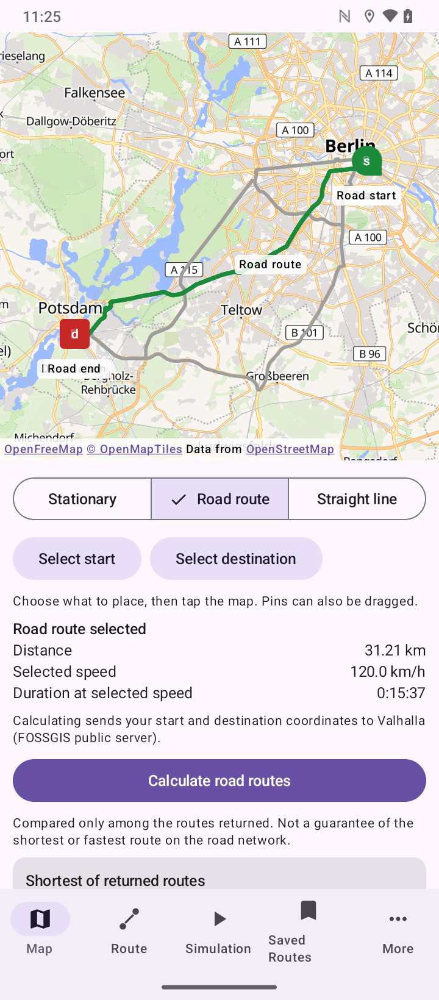
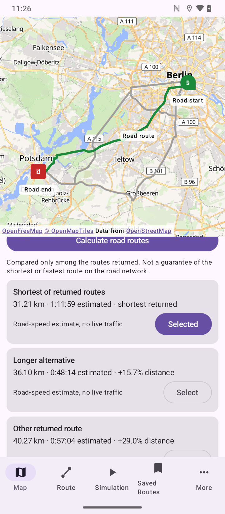
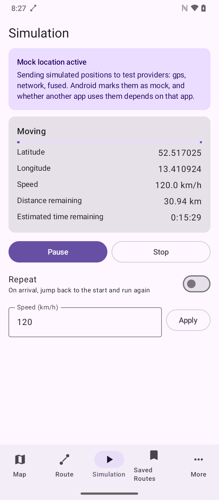
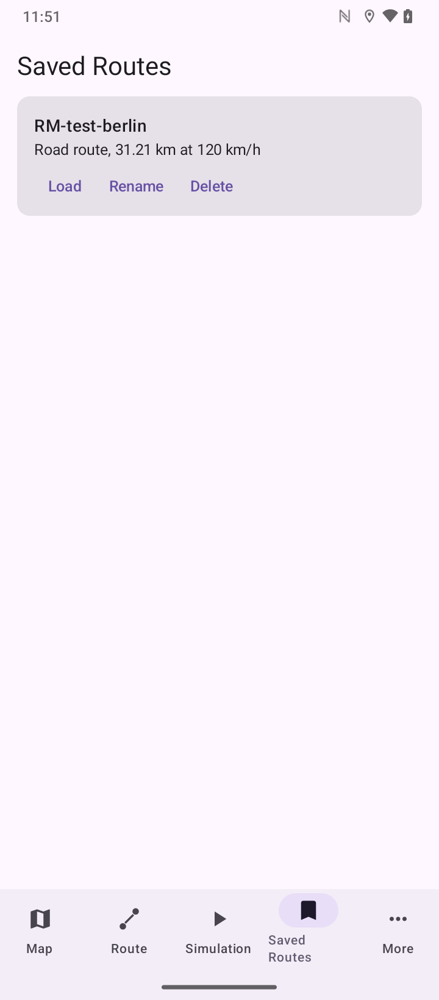
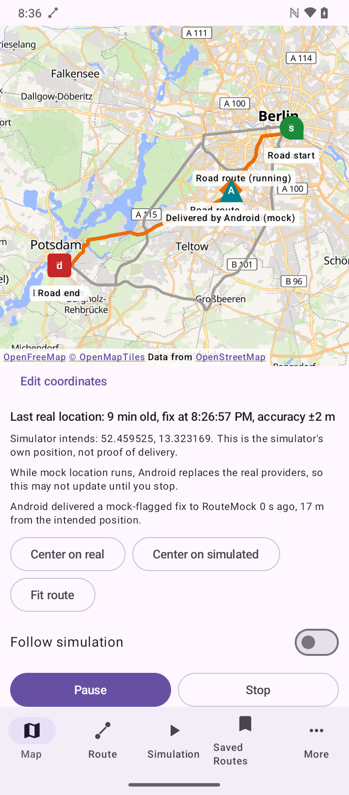
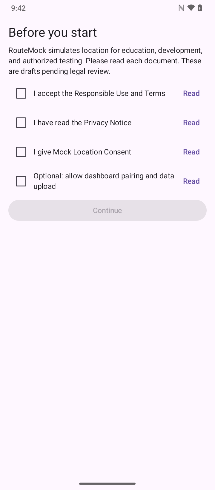
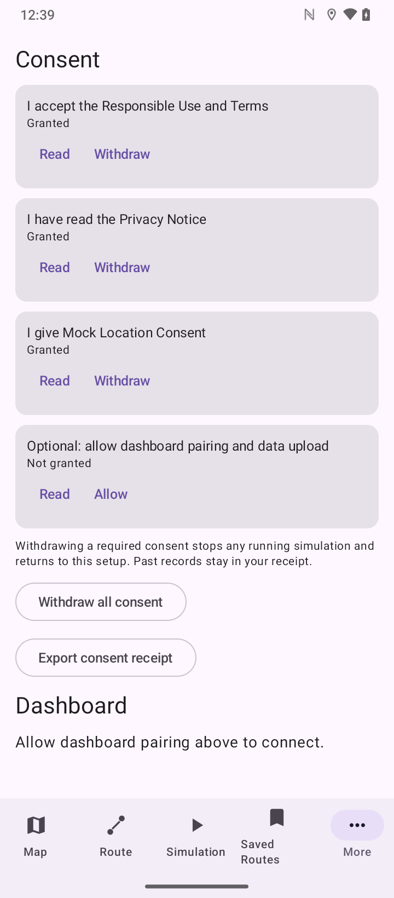
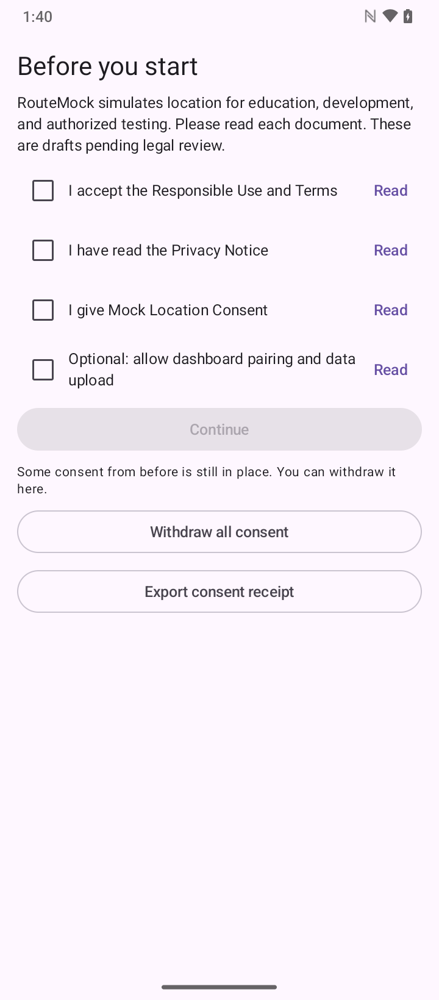
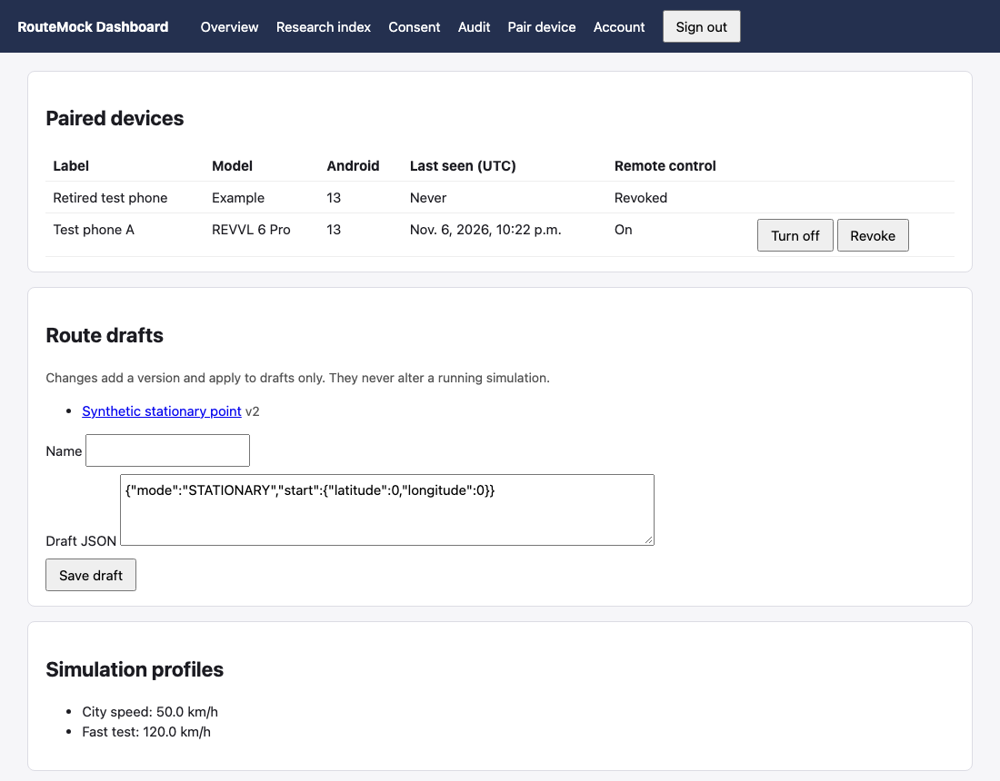
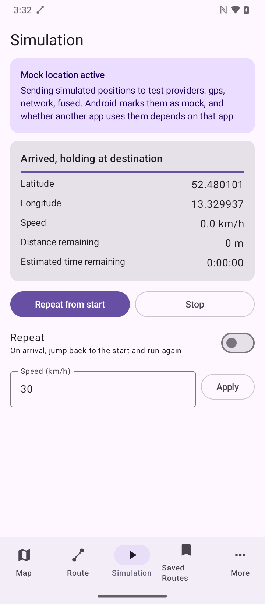

# RouteMock

An Android road-route simulation and testing platform with consent controls, a local authenticated
dashboard, and reproducible evidence.

It supplies a stationary position, movement along road geometry from a routing service, or movement
along a straight line, through Android's supported test-provider API. It needs no paid account or
API key.

**Straight line is a separate mode and is never used as a fallback.** It follows the
direct great-circle path and ignores roads, buildings, water, and terrain.

This is a testing tool. It does not change your physical location, and Android marks its
locations as mock.

**Evaluation scope:** one physical Android 13 phone, three played road routes, one routing provider,
and one map tile provider. See [Verification](#verification).

**Status:** version 0.4.8 in source; the test phone runs 0.4.7. Live traffic is **not configured**, and place-name search is not
implemented. The dashboard has only run locally and **is not ready to deploy**. No license has been
chosen yet, so all rights are reserved for now, and the consent documents are drafts pending legal
review.

| Road route | Comparing routes | Active simulation |
| --- | --- | --- |
|  |  |  |

| Paused at zero speed | Saved routes | Simulated versus delivered |
| --- | --- | --- |
|  |  |  |

| First-use consent | Consent settings (automated test state) | Withdrawal when gated |
| --- | --- | --- |
|  |  |  |



Screenshots use synthetic routes, and dashboard images use synthetic records. They were reviewed
individually and were captured on builds 0.4.0 to 0.4.2. The consent settings image shows an
automated test state, not anyone's acceptance.

## Documentation

| Topic | File |
| --- | --- |
| Architecture and data flow | [docs/ARCHITECTURE.md](docs/ARCHITECTURE.md) |
| Threat model | [docs/THREAT_MODEL.md](docs/THREAT_MODEL.md) |
| Dashboard setup and use | [docs/DASHBOARD_GUIDE.md](docs/DASHBOARD_GUIDE.md) |
| Dashboard deployment blockers | [docs/DEPLOYMENT.md](docs/DEPLOYMENT.md) |
| Security review | [docs/SECURITY_REVIEW.md](docs/SECURITY_REVIEW.md) |
| Test protocol | [docs/protocols/road-playback-2.md](docs/protocols/road-playback-2.md) |
| Evidence format | [docs/EVIDENCE_SCHEMA.md](docs/EVIDENCE_SCHEMA.md) |
| Research index | [docs/RESEARCH_INDEX.md](docs/RESEARCH_INDEX.md) |
| Privacy and retention | [docs/PRIVACY_AND_RETENTION.md](docs/PRIVACY_AND_RETENTION.md) |
| Consent documents | [docs/legal/README.md](docs/legal/README.md) |
| Consent scopes and withdrawal | [docs/CONSENT_SCOPES.md](docs/CONSENT_SCOPES.md) |
| Force-stop and recovery | [docs/FORCE_STOP_RECOVERY.md](docs/FORCE_STOP_RECOVERY.md) |
| Dashboard limitations | [docs/DASHBOARD_LIMITATIONS.md](docs/DASHBOARD_LIMITATIONS.md) |
| Final report | [docs/FINAL_REPORT.md](docs/FINAL_REPORT.md) |
| Verification report | [docs/samples/verification-report.md](docs/samples/verification-report.md) |
| Current status | [docs/samples/final-handoff.md](docs/samples/final-handoff.md) |
| Lint review | [docs/LINT_REVIEW.md](docs/LINT_REVIEW.md) |
| Reproducing results | [docs/REPRODUCIBILITY.md](docs/REPRODUCIBILITY.md) |
| Publication audit | [docs/PUBLICATION_AUDIT.md](docs/PUBLICATION_AUDIT.md) |
| Sample data | [docs/samples/README.md](docs/samples/README.md) |
| Location observer test tool | [tools/location-observer/README.md](tools/location-observer/README.md) |
| Licensing | [docs/LICENSING.md](docs/LICENSING.md) |
| Third-party notices | [THIRD_PARTY_NOTICES.md](THIRD_PARTY_NOTICES.md) |
| Reporting vulnerabilities | [SECURITY.md](SECURITY.md) |

## Consent

The first launch shows the Responsible Use and Terms, Privacy Notice, and Mock Location
Consent. All three must be accepted before the app can be used, and dashboard upload is a
separate optional choice. Every box starts unchecked. The documents are drafts pending legal
review.

The app keeps a receipt with document versions, content hashes, times, and app version, which
you can view, export, and act on in the More section. Changing a document requires accepting
it again. Withdrawing required consent stops any running simulation, and withdrawing upload
consent also revokes the device on the dashboard, immediately or, if offline, on reconnecting.
**Withdraw all consent** stays available even after a required consent is gone. Consent is enforced at the session boundary
and by the dashboard, not only on screen. Automated tests are recorded as `AUTOMATED_TEST`,
never as a user's decision.

## Dashboard

The optional dashboard in `dashboard/` is a private Django application for paired devices,
versioned drafts, test runs, evidence, and reports. **It has only been run locally, and it
must not be exposed without the review in [docs/DEPLOYMENT.md](docs/DEPLOYMENT.md).**

To set it up, follow the [dashboard guide](docs/DASHBOARD_GUIDE.md). The phone only ever connects out.
Remote control is off by default, and every requested
start needs approval on the phone. Local Stop works with no connection.

Sign-in uses a password and an authenticator app. Passkeys and malware scanning of uploads are not
implemented, records cannot be deleted, and the requirements in the deployment guide are unresolved.
See [docs/DASHBOARD_LIMITATIONS.md](docs/DASHBOARD_LIMITATIONS.md).

## Requirements

| Tool | Version | Notes |
| --- | --- | --- |
| JDK | 17 | Homebrew `openjdk@17` |
| Android SDK | platform 36, build-tools 36.0.0 | Homebrew `android-commandlinetools` |
| Gradle | 9.6.1 | Through the wrapper |
| Android Gradle Plugin | 9.5.0 | Uses AGP's built-in Kotlin support |
| Kotlin | 2.4.21 | |
| MapLibre Native Android | 13.7.1 | Map rendering, open source |
| Device | Android 10 (API 29) or later | Target test phone is Android 13 |

`compileSdk` is 36 because that is the installed platform. This pins `core-ktx`
to 1.18.0 and the Compose BOM to 2026.06.01, since later versions need compileSdk
37. Moving to them requires installing `platforms;android-37` first.

## Traffic status

Live traffic is **not configured**. See [Traffic](#traffic).

## Build

```sh
cp env.sh.example env.sh            # Once, then edit the two paths.
source ./env.sh                     # This shell only. Sets JAVA_HOME and ANDROID_HOME.
./gradlew :app:assembleDebug        # APK: app/build/outputs/apk/debug/app-debug.apk
./gradlew :app:testDebugUnitTest    # Unit tests
./gradlew :app:lintDebug            # Android lint
```

`local.properties` holds `sdk.dir`, and both it and `env.sh` are git-ignored because
they contain machine-specific paths.

To install on a connected phone:

```sh
adb install -r app/build/outputs/apk/debug/app-debug.apk
```

## Mock-location setup

RouteMock cannot select itself. You do this once, on the phone:

1. Open **Settings > About phone** and tap **Build number** seven times to enable
   Developer options. The location of this entry varies by manufacturer.
2. Open **Developer options** and tap **Select mock location app**.
3. Choose **RouteMock**.
4. Make sure device location is on.
5. In RouteMock, tap **Start mock location** and allow notifications when asked.

The Simulation section shows the state of each of these. If RouteMock is not
selected, Start explains this and offers a button that opens Developer options.
The choice itself is always yours.

## Map

The map uses [MapLibre Native](https://maplibre.org/) with
[OpenFreeMap](https://openfreemap.org/) vector tiles. Neither needs an account or
key. OpenFreeMap supports mobile apps through MapLibre Native, but it is a free
service provided as-is, with no availability guarantee, and may be discontinued
without notice. Public `tile.openstreetmap.org` tiles are deliberately not used:
that service is best-effort and forbids offline use and bulk downloading.

Attribution is shown as permanent text on the map. Do not remove it.

To use another provider, add these to the git-ignored `local.properties`:

```properties
routemock.mapStyleUrl=https://example.com/style.json?key=YOUR_KEY
routemock.mapAttribution=Attribution text your provider requires
```

Never put a key in a tracked file. A key set this way is still compiled into the
APK, where anyone holding the APK can extract it.

**Privacy:** the tile provider sees which map areas are requested, and therefore
roughly where you are looking, along with your IP address. MapLibre logging is
turned off so tile requests stay out of logcat.

## Road routing

### Provider

The default is [Valhalla](https://valhalla.github.io/valhalla/) on the public
FOSSGIS server, chosen after comparing these options in November 2026:

| Provider | Key or account | Alternatives | Distance-based route | Traffic-aware | Coverage | Cost and limits |
| --- | --- | --- | --- | --- | --- | --- |
| **Valhalla (FOSSGIS)** | None | Yes, may return none | Yes, `shortest` costing | No | Worldwide, OSM | Free, 1 request/s, limited commercial use, no uptime guarantee |
| OSRM demo server | None | Yes | No | No | Worldwide, OSM | Demo only, non-commercial, 1 request/s |
| GraphHopper | Key | Yes | Not checked | Not checked | Not checked | Free tier not confirmed |
| openrouteservice | Key | Not confirmed | Not confirmed | Not confirmed | Not confirmed | Limits page unavailable when checked |
| TomTom | Key | Not checked | Not checked | Yes | Commercial | 20K routing requests a month free, no card; see Traffic |

The service is run by volunteers and FOSSGIS may withdraw it at any time. **It suits
personal testing. For public distribution or heavy use, host Valhalla yourself or use
a commercial Valhalla provider.** Commercial use is allowed only if the service is not
a substantial part of the offering, and an app in a store must show a contact address.

RouteMock meets the server's rules by identifying itself with a User-Agent, sending at
most one request every 1.2 seconds, showing attribution with an error-reporting link,
and only sending requests when you tap **Calculate road routes**. Each calculation
makes two requests. Results depend on the OpenStreetMap data and may be wrong or out of
date.

To use another Valhalla endpoint, add to the git-ignored `local.properties`:

```properties
routemock.routingBaseUrl=https://your-valhalla.example
routemock.routingApiKey=OPTIONAL_KEY
routemock.routingProviderName=Name shown in the app
routemock.routingAttribution=Attribution text the provider requires
routemock.routingAllowsStorage=false
```

Set `routingAllowsStorage=true` only after checking that provider's terms. Another kind
of service can be added by implementing the `RoutingProvider` interface.

### What is sent

Tapping **Calculate road routes** sends the start and destination pin coordinates, and
your IP address, to the routing provider. Nothing is sent until you tap it. If a pin is
at your real location, then that location is what gets sent. Coordinates and keys are
not logged by RouteMock.

### Following the road

The selected geometry is played exactly. Position comes from cumulative segment
distance and monotonic elapsed time, interpolating within each segment, and bearing
comes from the segment being travelled. Pause, resume, and speed changes work as they
do for a straight line, and duplicate points and zero-length segments are dropped.

Playback starts at the **road start**, not at your pin, as roads rarely pass exactly
through a pin. The map shows *Road start* and *Road end* markers joined to the pins by
dashed lines, and the panel gives both distances.

### Comparing routes

Each route shows its distance, estimated time, extra distance, and what the time is
based on. Selecting one changes the draft only; simulation starts only from the
Simulation section.

- **Shortest of returned routes.** One of the two searches is distance-only, but the
  label stays this cautious because this is still only a comparison of what came back.
  It is not a guarantee of the shortest route on the road network.
- **Fastest estimate of returned routes.** Based on Valhalla's estimate, without
  traffic.
- **Longer alternative.** A returned route that is longer than the shortest, within
  your limit (50% by default), does not repeat part of its own path, and shares under
  90% of its road with the shortest. RouteMock does not search for long routes. If
  nothing qualifies, it says why.

Valhalla may return no alternates, as it did for a 3 km test route in central Berlin,
and a 40 km route returned two.

### When routing fails

RouteMock reports the cause: no road near a pin, no drivable path, too far apart, rate
limited, no connection, or a service error. Road mode then has no route, and starting
is refused. It never switches to a straight line by itself. Moving a pin also makes the
selected route stop applying until you calculate again.

### Traffic

**No live traffic is available, and the app shows "Live traffic not configured."**
Route times are labelled as road-speed estimates. Traffic never changes playback speed,
which is always your selected speed, and an active session never moves to a new route.

TomTom has a free tier with traffic tiles, but it was not integrated because its terms
could not be confirmed to permit this use. Clause 20.2 restricts combining its content
with open-source software or data in ways that could trigger copyleft, and the base map
is OpenStreetMap data under the ODbL. Clause 11.6.10 restricts using it alongside
competing products to compare them, and a route comparison is close to that. Clause
11.4 also limits caching. Get a clear answer from a provider before adding traffic.
`TrafficStatus` already models live, stale, and unavailable states for that work.

### Testing against the live service

Unit tests use recorded and synthetic data and never touch the network. One opt-in check
exercises the real client against the public server:

```sh
ROUTEMOCK_LIVE_ROUTING=1 ./gradlew :app:testDebugUnitTest --tests '*LiveValhallaCheck*' --rerun
```

Run it sparingly: it uses a volunteer service. Without the variable it is skipped.

### Saved routes

Road routes are saved with their geometry, provider, attribution, and time of
calculation, which the default provider's terms allow. For a custom provider, geometry
is kept only if `routingAllowsStorage=true`; otherwise only the pins are saved, and the
route must be calculated again. Routes saved by earlier versions keep working as
straight-line or stationary routes.

Saved geometry does not update, so it can go out of date as roads change.

### Selecting locations

Choose **Select start**, **Select destination**, or in Stationary mode **Select
stationary location**, then tap the map. Pins can also be dragged, and a tap with no
selection active does nothing. Pins and the coordinate fields are two views of the
same draft, so a change in either appears in the other.

**Pins only ever change the draft.** They never start injection or alter a running
session, which keeps the route it started with until you stop and start again.

### Markers

| Marker | Look | Meaning |
| --- | --- | --- |
| Start | Green teardrop, **S** | Draft start |
| Destination | Red square, **D** | Draft destination |
| Stationary | Purple teardrop, **P** | Draft stationary position |
| Road start, Road end | Small circles, **s** and **d** | Where the selected road route really begins and ends |
| Real location / Last real location | Blue circle, **R**, plus accuracy circle | Latest fix Android did not flag as mock |
| Simulated (intended) | Orange diamond, **M** | Where the simulator intends to be |
| Delivered by Android (mock) | Teal triangle, **A** | A mock-flagged fix Android returned to RouteMock |

The **intended** and **delivered** markers are deliberately separate. The first is
only the simulator's own state and proves nothing about delivery. The second appears
only when Android hands a mock-flagged fix back through `LocationManager`. That shows
the platform accepted and delivered the fix to RouteMock itself, not that any other
app received or used it.

### How real and mock fixes are kept apart

Every fix passes through `LocationObservations`, and Android's mock indicator decides
first (`Location.isMock`, or `isFromMockProvider` before Android 12). A flagged fix
has no path to the real marker. Stale, impossible, and out-of-order fixes are dropped.
An unflagged fix sitting within 1 m of the simulated position during injection is also
refused, in case a mock lost its flag.

**Live real GPS during mocking is not promised.** Test providers replace Android's
real `gps` and `network` providers. RouteMock records the last non-mock fix it has
just before injection starts. During injection, that fix stays on the map as *Last
real location* with its age and fix time. With no verified fix at all, the app shows
*Real location unavailable*.

Real coordinates are held in memory only: they are not logged, not written to saved
routes, and are lost when the process ends. Using *Center on real* does put that
position in the map camera, which Android keeps in the app's saved UI state.

Location is read only while the app is visible, which uses GPS and battery during
that time.

### Map controls and failure states

*Center on real*, *Center on simulated*, *Fit route*, and *Follow simulation* are in
the panel. Panning by hand turns Follow off. The camera and draft are preserved across
rotation and section switching.

The map shows loading, offline, map-service-error, and tile-error messages, with Retry
where it can help. Pins, lines, and all controls are drawn by the app rather than by
the map, so selection, coordinates, and simulation keep working without tiles, over a
blank background.

Each line shows the path playback follows. A selected road route is solid green, other
returned routes grey, a straight line dashed, and a running session orange. Road mode
draws no line until a route is selected, so a straight line never stands in for a road.

## Using the app

- **Map**: select locations, view markers, and control a running session.
- **Route**: choose Stationary or Straight line, then enter coordinates in decimal
  degrees and a speed in km/h or mph. The ± button flips a coordinate's sign, as
  many number keyboards have no minus key.
- **Simulation**: start, pause, resume, stop, repeat, and change speed mid-route.
- **Saved Routes**: load, rename, and delete routes stored on the device.

### Preview versus mock location

| | Preview in app only | Start mock location |
| --- | --- | --- |
| Other apps see it | **No** | Those reading a mocked provider, if they accept mock locations |
| Needs setup | No | Yes |
| Foreground service and notification | No | Yes |
| Survives leaving the app | Not guaranteed | Yes |

The active session is labelled at the top of the Simulation section.

## Permissions

| Permission | Why |
| --- | --- |
| `ACCESS_MOCK_LOCATION` | Lists RouteMock under *Select mock location app*. Selecting it there is what authorizes it. |
| `FOREGROUND_SERVICE` | Keeps injection running outside the UI. |
| `FOREGROUND_SERVICE_SPECIAL_USE` | The service type on Android 14 and later. |
| `POST_NOTIFICATIONS` | Shows the required notification and its controls. Mock location will not start without it. |
| `WAKE_LOCK` | Keeps supplying fixes with the screen off. Held only during a session. |
| `ACCESS_FINE_LOCATION`, `ACCESS_COARSE_LOCATION` | **Optional.** The real-location marker and observing delivery. Requested only from the map. |
| `INTERNET`, `ACCESS_NETWORK_STATE` | Map tiles, routing requests, dashboard, and the offline message. |

Injection does not need the location permission. If you refuse it, there is no real
marker and delivery cannot be observed, but the map and simulation still work. Foreground
location is enough, and RouteMock never asks for background location.

The service uses the `specialUse` type because `location` would make that permission
mandatory on Android 14 and later. Distributing through Google Play would mean
justifying `specialUse` to Play's reviewers, and Play's policies would need reviewing
in general. MapLibre also declares `ACCESS_WIFI_STATE`, which is removed from the
manifest as nothing here uses it.

## Network security

These protections are in place. They reduce risk, and do not make the app completely
secure.

- **HTTPS only.** Cleartext is disabled in the manifest and in
  `network_security_config.xml`. Map, tile, and routing traffic all use HTTPS.
- **Normal certificate checks.** Only the system certificate store is trusted, with
  platform certificate and hostname verification. There are no custom trust managers,
  hostname verifiers, or debug certificate overrides. Debug builds differ in one way:
  they may reach `http://127.0.0.1` for a local dashboard over `adb reverse`. Pinning is deliberately not used: it would break the app whenever a free
  provider changes certificates, and there is no operational need for it.
- **Configured addresses are checked twice.** A non-HTTPS map or routing address fails
  the build, and the app refuses it at runtime before sending anything. Routing addresses
  must also have no embedded credentials, query, or fragment.
- **Redirects are never followed**, so a key in a request URL cannot reach another host
  or drop to HTTP.
- **Limits.** Connect and read timeouts are 20 seconds, responses over 8 MiB are
  abandoned, routing requests are spaced at least 1.2 seconds apart, and a request for
  pins that have since moved is cancelled, closing its connection.
- **Responses are validated.** Coordinates must be in range, geometry must be intact and
  under 200,000 points, travel time must be valid, and both ends must be within 10 km of
  the pins. Anything else is rejected.
- **Failures are specific and safe.** TLS, timeout, offline, malformed response, redirect,
  and server errors each show their own message. None of them change the route mode.
- **No logging of sensitive data.** The app logs nothing, MapLibre logging is off, and
  routing errors carry no URLs, keys, or coordinates.
- **Components.** Only `MainActivity` (the launcher) is exported, and it takes no
  simulation commands. `SimulationService` is not exported, so other apps cannot control
  a session. Compose tooling, which added an exported debug activity, was removed.
  `ProfileInstallReceiver` from AndroidX is exported but requires the `DUMP` permission.
  PendingIntents are immutable and explicit.

**Keys in an APK can be extracted.** Anything set in `local.properties` is compiled into
the app, and anyone with the APK can read it. Keep keys out of source control, and use the
provider's own restrictions, such as limiting a key by app or API. A backend is needed
only for a genuinely secret credential, and none is used here. No key is needed by
default.

**Remaining limitations:** API keys for custom providers travel in the URL, as those
services require. MapLibre's own tile requests use its HTTP client: they are covered by
the cleartext ban, but not by the redirect, size, and geometry rules above. The tile and
routing providers see your IP address and requested areas. A rooted device or a
user-installed system certificate can defeat these checks. No security audit or
penetration test has been done.

## How it works

```
domain/      Pure Kotlin: coordinates, geodesy, routes, units, validation, map drafts
routing/     RoutingProvider interface, Valhalla client, route comparison, traffic status
playback/    Pure Kotlin: PlaybackEngine, location-fix building, formatting
simulation/  SimulationController: the session, tick loop, and LocationSink contract
location/    Real/mock fix classification (pure) and the Android location reader
mock/        Android test-provider injection, session journal, readiness checks
service/     Foreground service and notification
data/        Saved routes in one private JSON file, replaced atomically
ui/          Jetpack Compose screens and the ViewModel
```

**Position is derived, never accumulated.** Progress is
`anchorDistance + speed * (now - anchorTime)` on `SystemClock.elapsedRealtimeNanos()`,
which is monotonic and counts deep sleep. A late tick means a position is sampled
later, not that it is wrong. Pause, resume, and speed changes move the anchor to the
current position, so paused time is excluded and a speed change cannot make the
position jump.

**Session state lives in the process**, in `SimulationController`, so rotation and
switching sections do not touch it. Form text is kept in the saved-state bundle.

**Fixes** are published once a second and on every command. Each carries the
coordinates, wall-clock time, elapsed-realtime timestamp, and accuracy, plus speed
and speed accuracy. Bearing and bearing accuracy are included only while moving.
Altitude is left unset, as there is no real value for it. While paused, stationary,
or arrived, fixes continue at zero speed so the position stays fresh.

## Stopping and restoring your real location

Stop removes the test providers and the foreground service. An error does the same,
and tells you what went wrong.

**Your real location does not return instantly.** The device must get a new fix from
GPS or the network, which can take a while, especially indoors. Until then, apps may
show the last simulated position.

If the process is killed mid-session, for example by force-stop, RouteMock does **not**
restart simulation. The service is not sticky. Android also removes the notification, so
nothing shows that the test providers are still registered. **If the notification disappears
without you pressing Stop, open RouteMock.** A journal on disk records that providers may
exist, so RouteMock removes them as it starts and opens on a notice saying so. Until you
reopen it, apps can still read the last simulated position, frozen. If RouteMock cannot be
opened, restart the phone (not tested).

## Limitations

- **Time zone:** with automatic time zone on, Android can change the phone's time zone to
  match a simulated location, and it can stay changed after Stop until the phone gets a new
  real location. This was observed on the test phone.
- **After a force-stop, test providers stay registered** until RouteMock is reopened. No new
  mock fixes are produced, but the last known position stays a stale simulated one. Android gives
  the app no chance to clean up. Opening RouteMock fixes it. This was seen on the phone (Android 13)
  and again on an Android 14 emulator. See
  [recovery notes](docs/FORCE_STOP_RECOVERY.md).
- **Evaluation is narrow:** one phone, three played routes, and one routing provider. Arrival was
  observed on two short routes, delivery was shown to one test app, and most device results predate
  0.4.7.
- **The Simulated and Delivered markers can overlap**, so one label may hide the other.
- **Routing availability** depends on a volunteer-run server with no guarantee. Very
  long routes can be refused.
- **Route quality** depends on OpenStreetMap data and Valhalla's car model. One-way
  rules and restrictions are as good as that data.
- **Corners are instant:** bearing changes at each point with no smoothing, and speed
  does not slow for bends.
- **A very long selected route** is not kept if Android kills the app, because it would
  exceed the saved-state limit. It survives rotation, and saved routes keep it.
- **Tile availability** depends on OpenFreeMap's free service, which has no guarantee.
- **The real location can be stale or absent** during injection, by design. The
  pre-injection capture uses Android's last known fixes, so it can be old, and there
  may be none if location was never available.
- **Delivery is only observed while the app is visible** and has location permission,
  and it covers delivery to RouteMock. Delivery to a separate test app was checked once, with the
  [location observer](tools/location-observer/README.md).
- **Offline map areas** cannot be downloaded.
- **The debug APK is about 84 MB** because it carries MapLibre for four CPU types.
- **Compatibility is not universal.** Android marks these locations as mock, and
  RouteMock makes no attempt to hide that. Apps may detect, ignore, or reject them.
- **Google Play services fused location** is not mocked directly. RouteMock mocks the
  platform `gps` and `network` providers, plus `fused` on Android 12 and later. Apps
  using the Play services client may see different results from those reading
  `LocationManager`, and real sensor data may influence them.
- **Geodesy is spherical**, at most about 0.5% from the WGS84 ellipsoid. Distances
  can differ slightly from other tools.
- **Repeat jumps** from the destination back to the start, which appears as a
  teleport to anything watching.
- **Altitude is not simulated.**
- **Battery**: the wake lock keeps the CPU awake for the whole session.
- **The notification can be swiped away on Android 14 and later**, where the platform
  allows this for foreground services. Injection continues and it is reposted on the
  next update. Stationary or paused sessions may not repost it until you open the app.
  This was not tested, as the test phone runs Android 13.
- **Interface text is English only**, and coordinates must use a `.` decimal point.
- **Only one session runs at a time**, and a running session does not change when you
  edit the Route section.

## Verification

Evidence is kept in five separate kinds, which are not added together. The
[verification report](docs/samples/verification-report.md) has every check and its build.

| Kind | PASS | FAIL | NOT TESTED | Notes |
| --- | --- | --- | --- | --- |
| Physical-device checks | 37 | 1 | 4 | One REVVL 6 Pro on Android 13. 10 PASS on 0.4.7; the rest are from 0.4.0 to 0.4.5 |
| Automated tests | 390 | 0 | | 299 Android and 91 dashboard, on 0.4.8; 1 opt-in network test skipped |
| Static APK inspection | 6 | 0 | | Release APK read without running it |
| Live-provider checks | 6 | 0 | | Public Valhalla server. 2 on 0.4.7; 4 historical |
| Emulator checks | 16 | 1 | | Android 14 emulator, API 34: compatibility and force-stop. Not a physical device, and not counted above |

**The one FAIL** is a known limitation: after a force-stop, test providers stay registered until
RouteMock is reopened, and the last known position stays a stale simulated one. The simulation itself
does not restart. The emulator FAIL is the same limitation reproduced on Android 14, where reopening
RouteMock removed the providers about 1.1 s after launch. See the
[recovery notes](docs/FORCE_STOP_RECOVERY.md).

**Road playback on 0.4.7:** 127 fixes observed through Android's own records, all mock-flagged. The
worst distance from the road was 0.057 m, through 5 sharp turns. Speed stayed within 0.013% of the
selection at 120 and 60 km/h. The run covered the first 3.54 km of a 31.21 km route, and malformed
dashboard replies served during it had no effect. See the
[export](docs/samples/report-export-0.4.7/derived/report.html).

**Road arrival on 0.4.7:** a separate run on a 1.32 km route at 30 km/h went from start to destination
with no intervention. All 181 fixes were mock-flagged, within 0.055 m of the road. Android delivered
the exact final point, and arrival came 0.35 s after the expected 158.31 s. The app then held the
destination at zero speed until Stop, as expected. See the
[export](docs/samples/report-export-road-arrival-1/derived/report.html).



**Delivery to a separate app:** a separately installed test app, listening through `LocationManager`,
received 198 fresh mock fixes, matching Android's own record one for one, including 53 during the
endpoint hold. It received no mock fix in the 92 seconds after Stop. This covers one test app, not apps
using Google Play services or apps that reject mock locations. See the
[report](docs/samples/report-export-observer-delivery-1/derived/report.html).

### Verified features

Confirmed on the phone, on the build shown in the report:

- Road playback, including turns, pause, resume, live speed changes, and arrival
- Delivery to one separate test app, and no fresh mock fixes after Stop
- Stop cleanup of providers, service, wake lock, and notification
- Notification controls, rotation, section switching, background, and brief screen off
- The consent gate, withdrawal online and offline, and test-event labeling
- Pairing, approved and rejected remote starts, and local Stop with the dashboard down

Route calculation and comparison were confirmed against the live routing server. Consent at the
session boundary is covered by unit tests, as a phone cannot reach it directly.

### Not tested

A real low-memory process death, the
release APK on a device, a phone restart clearing leftover providers, Android 14 or later on a physical phone (an Android 14 emulator passed separately), device-to-device transfer, and any deployment of the
dashboard.

### Reproducing the results

```sh
cp env.sh.example env.sh        # Then edit the two paths.
source ./env.sh
./gradlew clean :app:assembleDebug :app:assembleRelease :app:testDebugUnitTest :app:lintDebug --rerun-tasks --no-build-cache
(cd dashboard && python3 -m venv .venv && .venv/bin/pip install -r requirements.txt && .venv/bin/python manage.py test core)
shasum -a 256 -c docs/EVIDENCE_MANIFEST.sha256
```

Expect Android 300 tests with 299 passed and 1 skipped, lint with 0 errors and 8 warnings, and
dashboard 91 passed. [docs/REPRODUCIBILITY.md](docs/REPRODUCIBILITY.md) has the full steps.

## License status

**No license has been chosen.** Until one is, all rights are reserved: you may read this code, but no
right to use, change, or share it is granted. The choices are set out in
[docs/LICENSING.md](docs/LICENSING.md). Third-party components keep their own licenses, listed in
[THIRD_PARTY_NOTICES.md](THIRD_PARTY_NOTICES.md), and OpenStreetMap-derived data stays under the ODbL.

## Manual test checklist

Unit tests cannot cover these. Mark each one on a real device.

Use a separate GPS-reading app to observe results, or run
`adb shell dumpsys location` to see provider state.

**Road routes**

- [ ] Calculate road routes returns real routes, with the privacy notice visible first.
- [ ] Shortest, fastest, and longer labels, stats, and traffic basis are shown.
- [ ] Selecting a route draws it and shows Road start and Road end offsets.
- [ ] Selecting a route during a session does not change the session.
- [ ] Preview and mock location both follow the road, including corners.
- [ ] A pin in the ocean shows the no-road error, and nothing starts.
- [ ] With no network, the failure is shown, and there is no straight-line fallback.
- [ ] Moving a pin marks the route outdated, and Start is refused.
- [ ] A saved road route reloads with the same geometry after an app restart.
- [ ] A straight-line route saved by an earlier version still works.

**Map**

- [ ] Tapping with no selection mode does nothing.
- [ ] Select start and Select destination place pins, and dragging moves them.
- [ ] Pin coordinates and the coordinate fields stay in sync in both directions.
- [ ] Stationary mode offers one pin, which is what the session then supplies.
- [ ] Dragging a pin during a session changes neither the simulated marker nor its route.
- [ ] Rotation and section switching keep pins, the camera, and the selection mode.
- [ ] Center on real, Center on simulated, and Fit route move the camera correctly.
- [ ] Follow tracks the simulation, and panning by hand turns it off.
- [ ] In airplane mode, the offline message shows and pins and simulation still work.
- [ ] Refusing location shows the denied message, with no real marker.
- [ ] During injection, the real marker reads Last real location with a growing age.
- [ ] A mock position never appears on the real marker, including just after Stop.
- [ ] The Delivered marker appears only after Android returns mock-flagged fixes.
- [ ] No real coordinates appear in `adb logcat`.

**Setup and errors**

- [ ] Before selecting RouteMock, Start shows the setup error and opens Developer options.
- [ ] RouteMock appears in *Select mock location app*.
- [ ] After selecting it and returning, the setup card shows Ready without a restart.
- [ ] Denying notifications blocks Start, and the message opens notification settings.
- [ ] With device location off, the warning appears during a session.

**Preview**

- [ ] Preview moves the numbers and is labelled as in-app only.
- [ ] A separate GPS app still shows the real location during preview.
- [ ] No notification appears during preview.

**Stationary**

- [ ] The GPS app shows the chosen coordinates, with zero speed.
- [ ] The location is still supplied after 10 minutes with the screen off.

**Movement**

- [ ] Position advances at the chosen speed in both km/h and mph.
- [ ] Distance and time remaining fall at the expected rate.
- [ ] Bearing and speed appear in the GPS app.
- [ ] Pause holds the position at zero speed. Resume continues without a jump.
- [ ] Changing speed mid-route does not make the position jump.
- [ ] On arrival it holds the destination at zero speed until Stop.
- [ ] Repeat from start works, and the Repeat switch loops automatically.

**Service and lifecycle**

- [ ] The notification is shown during a session, and Pause, Resume, and Stop work from it.
- [ ] Rotating during a session keeps state, including the form and the selected section.
- [ ] Switching sections keeps state.
- [ ] Leaving the app keeps a mock session running.
- [ ] After Stop, `dumpsys location` shows no test providers and real location eventually returns.
- [ ] Deselecting RouteMock mid-session stops it with a clear error.
- [ ] After `adb shell am force-stop com.routemock.app`, simulation does not restart by
      itself, and reopening the app opens on the interruption notice and cleans up.

**Saved routes**

- [ ] Save, load, rename, and delete work, and routes survive an app restart.

**Input handling**

- [ ] Out-of-range coordinates, zero speed, and identical endpoints show clear errors.

## References

- [`LocationManager`](https://developer.android.com/reference/android/location/LocationManager)
  (`addTestProvider`, `setTestProviderLocation`, `removeTestProvider`)
- [`Location.isMock`](https://developer.android.com/reference/android/location/Location#isMock())
- [Android network security configuration](https://developer.android.com/privacy-and-security/security-config)
- [Valhalla route API](https://valhalla.github.io/valhalla/api/route/api-reference/)
- [FOSSGIS server terms](https://www.fossgis.de/arbeitsgruppen/osm-server/nutzungsbedingungen/)
- [OSRM demo server](https://github.com/Project-OSRM/osrm-backend/wiki/Demo-server)
- [GraphHopper routing API](https://docs.graphhopper.com/openapi/routing)
- [TomTom pricing](https://docs.tomtom.com/pricing) and [terms](https://docs.tomtom.com/legal/terms-and-conditions)
- [OpenFreeMap quick start](https://openfreemap.org/quick_start/) and [terms](https://openfreemap.org/tos/)
- [OSM tile usage policy](https://operations.osmfoundation.org/policies/tiles/)
- [Foreground service types](https://developer.android.com/develop/background-work/services/fgs/service-types)
- [Restrictions on starting a foreground service from the background](https://developer.android.com/develop/background-work/services/fgs/restrictions-bg-start)
